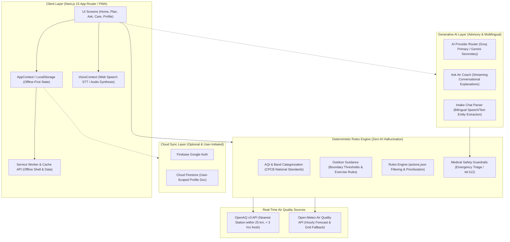
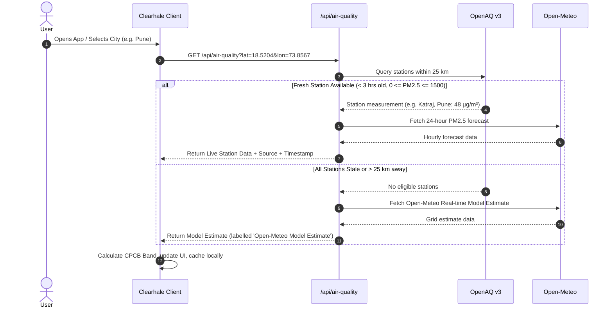

# Clearhale System Architecture & Data Flow

Clearhale is an offline-first clean air intelligence platform designed for Indian households. This document explains the system topology, component responsibilities, state management, and the explicit boundary between deterministic rules and generative AI.

---

## 1. High-Level System Architecture

---

## 2. Division of Responsibility: Code vs. Generative AI

To ensure complete medical and physical safety, Clearhale strictly separates deterministic logic from generative language models:

| Responsibility | Executed By | Mechanism | Why This Matters |
| :--- | :--- | :--- | :--- |
| **AQI Banding & Levels** | **Deterministic Code** | `lib/aqi.ts`, `lib/outdoorGuidance.ts` | Prevents AI hallucination on pollutant health risk levels. |
| **Outdoor Workout Recommendations** | **Deterministic Code** | `outdoorGuidance.ts` (Waking hrs 7am-11pm, PM2.5 <= 60 µg/m³) | Guarantees users are never told to exercise outdoors during dangerous smog. |
| **Mitigation Actions Selection** | **Deterministic Code** | `lib/rulesEngine.ts` filtering `data/actions.json` | Every recommendation is rooted in verified scientific literature (WHO/EPA). |
| **Emergency Symptom Triage** | **Deterministic Code** | `lib/medicalSafety.ts` regex triage | Intercepts chest pain, severe asthma attacks, and directs to emergency services (`tel:112`). |
| **Wrong-City Station Bounds** | **Deterministic Code** | `lib/openaq.ts` (Haversine <= 25 km threshold) | Prevents associating air quality from distant cities. |
| **Conversational Coaching** | **Generative AI** | Groq Llama 3 / Google Gemini 2.5 | Explains science in natural, encouraging conversational tones. |
| **Multilingual Voice & Chat** | **Generative AI** | Dual-LLM routing with bilingual fallbacks | Allows non-English speakers to ask questions in Hindi, Marathi, Bengali, Tamil, Telugu. |
| **Conversational Onboarding** | **Hybrid** | AI extracts entities; rule engine merges profile | Guarantees safe schema validation even with free-form speech inputs. |

---

## 3. Data Pipeline & Sensor Station Routing

---

## 4. Privacy & Data Lifecycle

1. **Local-First Default**: By default, no personal profile data leaves the client device. Household profile, selected actions, and theme preferences reside entirely in `localStorage`.
2. **Optional Cloud Sync**: If a user clicks **"Continue with Google"**, Firebase Auth authenticates the user, and their structured clean-air profile is synced strictly to their personal Firestore document (`users/{uid}`).
3. **AI Chat & Voice Audio**:
   - Audio recorded during voice input is streamed to the server STT endpoint solely for transcription and is immediately discarded. No audio recordings or transcripts are permanently persisted on any database or third-party log.
   - Text prompts sent to LLM providers contain only the user's inquiry, general AQI band, and anonymized household flags (e.g., "household has child, elderly, asthma"). No PII (names, emails, exact street addresses) is ever transmitted to AI providers.
